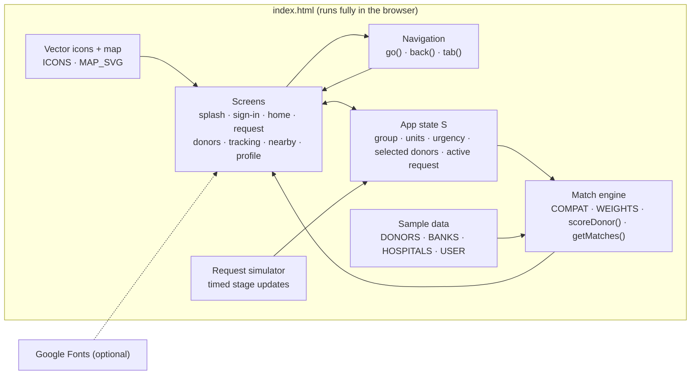
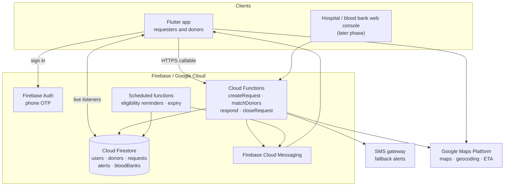
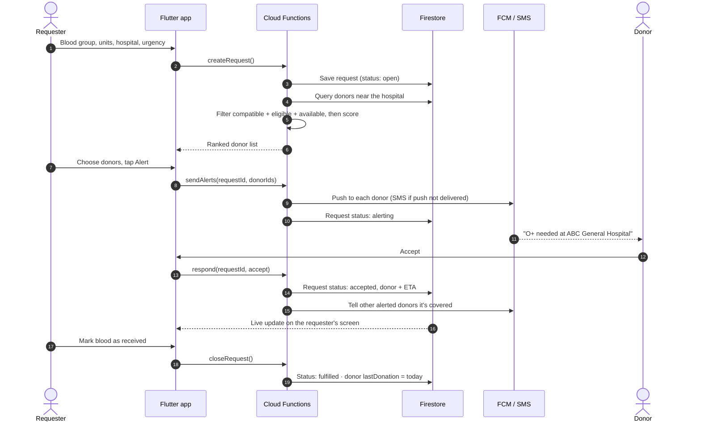
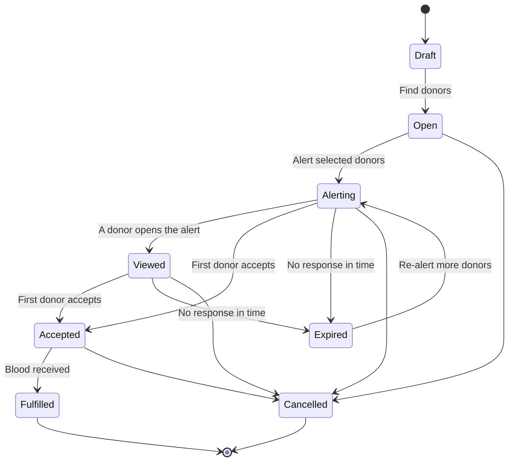
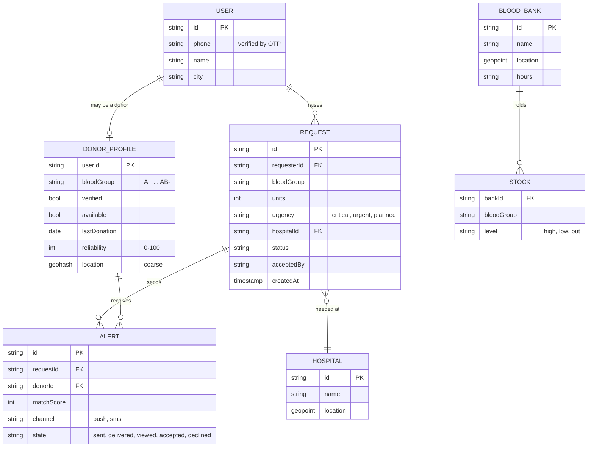

# BloodAid — Technical Design Document

| | |
|---|---|
| **Status** | Prototype built; production design proposed |
| **Version** | 0.1 |
| **Last updated** | 26 Oct 2026 |

Diagrams are written in Mermaid and render directly on GitHub.

---

## 1. Problem

When a patient needs blood urgently, families and hospitals often fall back on phone calls and social media posts. That is slow, it reaches people who can't donate (wrong group, recently donated, far away), and nobody knows who has actually agreed to come.

## 2. Goals and non-goals

**Goals**

- Raise a request in under a minute: blood group, units, hospital, urgency.
- Reach only donors who are compatible, eligible, available and nearby.
- Rank donors with a transparent score the requester can understand.
- Show live progress from "alert sent" to "donor on the way" to "blood received".
- Respect donor health (cooldown between donations) and privacy (no exact home location shared).

**Non-goals (for now)**

- Replacing hospital cross-matching or blood bank processes. BloodAid connects people; clinical checks still happen at the hospital.
- Blood bank inventory management. Stock levels are read-only.
- Payments of any kind.

## 3. Scope of this repository

This repo contains the **clickable prototype**: a single HTML file with dummy data that demonstrates the full user flow and runs the real matching logic in the browser. The production architecture in section 5 is the **proposed** design the prototype is built to validate.

| Area | Prototype (this repo) | Production (proposed) |
|---|---|---|
| Client | Single `index.html` (HTML, CSS, vanilla JS) | Flutter app (Android, iOS) |
| Sign-in | Simulated OTP | Firebase Auth phone OTP |
| Data | In-memory arrays (`sample-data/` mirrors them) | Cloud Firestore |
| Matching | In the browser (`getMatches`, `scoreDonor`) | Cloud Function, same algorithm |
| Notifications | Simulated timeline | Firebase Cloud Messaging + SMS fallback |
| Map | Stylised vector mock | Google Maps SDK |
| Location | Fixed coordinates | Device GPS, stored coarsened |

## 4. Prototype architecture



Every screen is re-rendered from state by a `RENDER.<screen>()` function, so the UI always reflects the current request, selection and timeline. There is no build step and no server.

## 5. Production architecture (proposed)



**Why this stack:** phone OTP, push notifications and real-time listeners are all built into Firebase, which keeps a small team focused on the matching and the user experience. Firestore listeners give the requester live tracking without polling.

## 6. Main flow: raising a request



## 7. Request lifecycle



In the prototype these map to `S.request.stage` 0 to 4 (created, delivered, viewing, accepted, received). Cancelling deletes the request.

## 8. Data model



The prototype's `sample-data/*.json` files follow a simplified version of these shapes.

## 9. Matching algorithm

Matching happens in three steps.

**Step 1: compatibility filter.** Only donors whose group can give red cells to the patient's group are considered.

| Patient needs | Can receive from |
|---|---|
| O− | O− |
| O+ | O+, O− |
| A− | A−, O− |
| A+ | A+, A−, O+, O− |
| B− | B−, O− |
| B+ | B+, B−, O+, O− |
| AB− | AB−, A−, B−, O− |
| AB+ | all groups |

**Step 2: split.** Compatible donors who are in cooldown or not taking requests are shown separately as "Not available now" and are never alerted.

**Step 3: score and rank** the rest out of 100:

| Factor | Weight | How it's scored |
|---|---|---|
| Blood match | 30 | 1.0 for the exact group, 0.9 for a compatible group (keeps scarce O− for those who need it) |
| Availability | 20 | 1 if the donor is taking requests |
| Distance | 20 | 1.0 within 1 km, falling linearly to 0 at 10 km |
| Verified | 15 | 1 if identity and blood group are verified |
| Reliability | 10 | Past response rate (0–100%) |
| Eligibility | 5 | 1 if out of cooldown (0.3 otherwise) |

```
score = Σ (factor value × weight), rounded
```

Worked example (O+ request): Rahul is O+, 1.2 km away, verified, 96% reliable:
30 + 20 + 19.6 + 15 + 9.6 + 5 = **99**.

The app shows this breakdown under "Why 99%?" so requesters can trust the ranking. The top three ready donors are pre-selected; the requester can change the selection before alerting.

## 10. Eligibility

- The prototype uses a fixed **84-day** gap between donations (`COOLDOWN_DAYS`).
- Real intervals depend on sex, donation type (whole blood, platelets, plasma) and national guidelines. **The production rule must be set from the current NBTC (National Blood Transfusion Council) guidelines and confirmed with a medical advisor before launch.**
- During cooldown a donor is hidden from requests and can turn on a reminder for their eligible date.

## 11. Notifications

| Event | Push | SMS fallback | Notes |
|---|---|---|---|
| New alert to donor | Yes | If push not delivered within 60 s | Contains group, hospital, urgency; never the patient's name |
| Donor accepted | Yes (requester) | Yes | Includes donor first name and ETA |
| Request covered | Yes (other donors) | No | Stops donors travelling unnecessarily |
| Eligible again | Yes | No | Only if the donor turned the reminder on |

## 12. Security and privacy

- **Location:** donor locations are stored as a coarse geohash. Requesters see distance only; a donor's live location is shared only after they accept, and only until the request closes.
- **Phone numbers:** hidden behind in-app calling or a masked relay; never shown in lists.
- **Access rules:** Firestore security rules restrict each user to their own profile and requests; matching runs server-side so the full donor list is never sent to a client.
- **Consent:** donors opt in to being visible and can turn it off at any time.
- **Health data:** blood group and donation dates are personal health information. Collect the minimum, encrypt at rest (Firebase default), and follow India's Digital Personal Data Protection Act, 2023.
- **Abuse:** rate-limit requests per user and flag repeated cancelled requests.

## 13. Scalability

- Donor search queries a geohash range around the hospital, so cost grows with local density, not total users.
- Alerts are sent in a batch per request; Cloud Functions scale automatically.
- If a request isn't accepted within a set time, the next-ranked donors are alerted automatically (proposed).

## 14. Testing

- **Automated:** `npm test` runs unit tests on the matching engine, compatibility table, eligibility dates and sample data, using Node's built-in test runner (no dependencies).
- **Manual:** [`tests/TEST_CASES.md`](../tests/TEST_CASES.md) lists 35 UI test cases with expected results.

## 15. Known limitations of the prototype

- All data is dummy data; nothing is sent anywhere.
- Sign-in, notifications and donor responses are simulated with timers.
- The demo date is fixed at 26 Oct 2026 so the cooldown story stays consistent.
- The map is a stylised illustration, not real geography.
- The 84-day cooldown is a placeholder rule (see section 10).

## 16. Future work

- Build the Flutter app and Cloud Functions from this design.
- Hospital console to raise and confirm requests directly.
- Automatic re-alerting and escalation for critical requests.
- Live blood bank stock via integration with e-RaktKosh or bank systems, where available.
- Regional language support (Tamil, Hindi).
